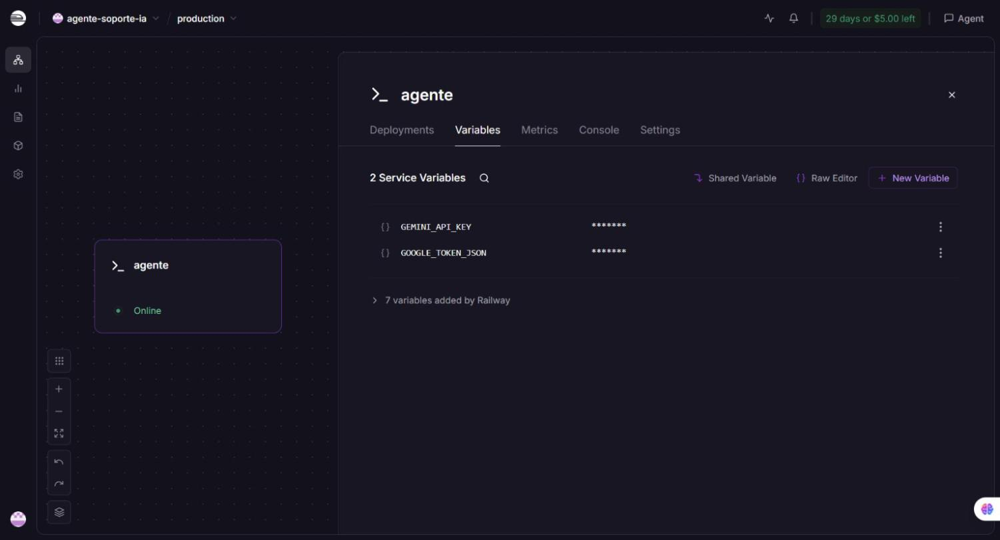
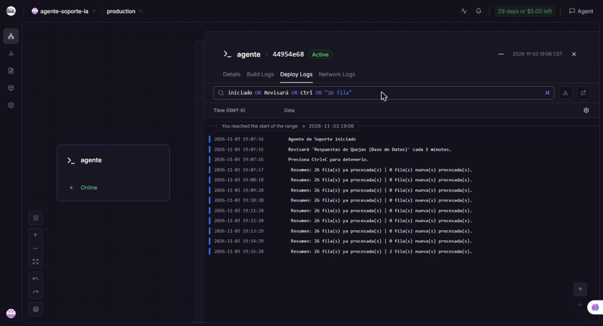
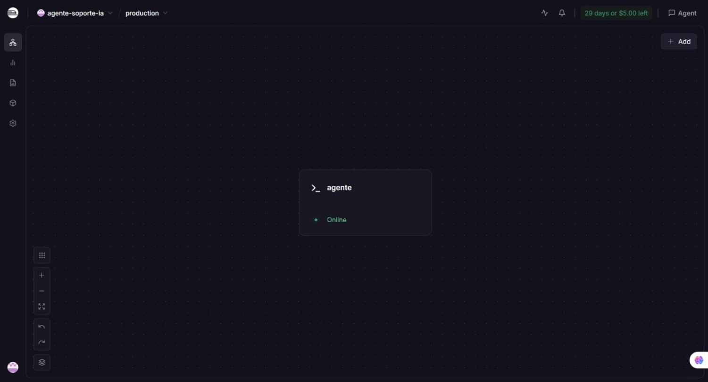
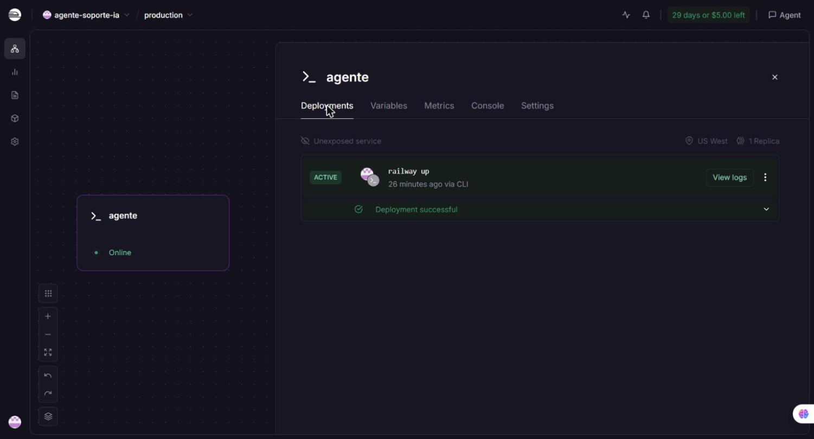
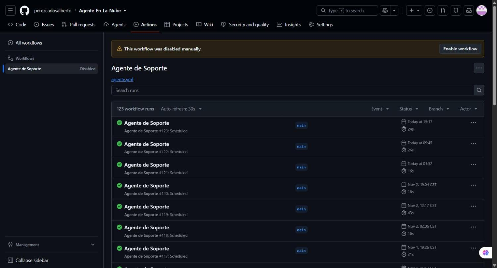
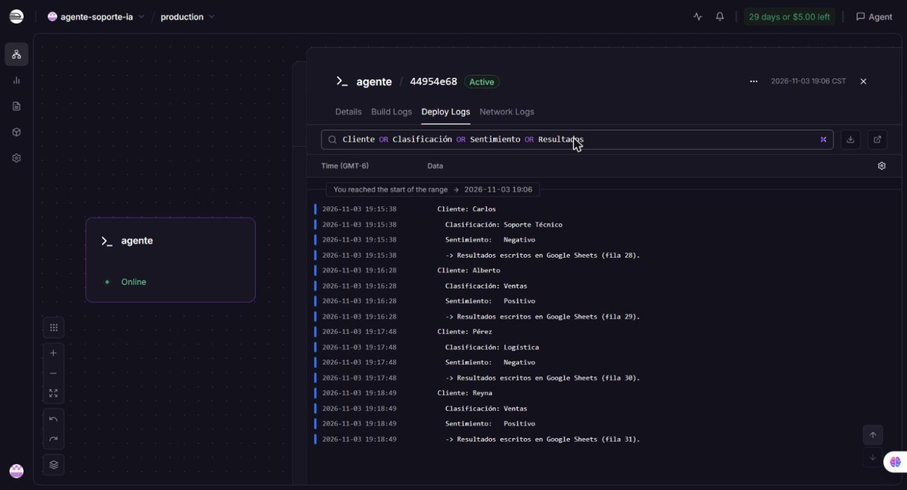
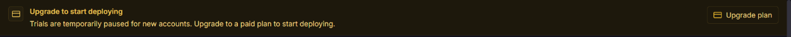

# Práctica 4: Mi Agente en la Nube — Railway

**Desarrollo de Agentes Inteligentes · Unidad 2 · TecNM Campus Ciudad Madero**

El Agente de Soporte (Google Forms → Google Sheets → Gemini) que en la Práctica 3 quedó empaquetado en un
contenedor Docker ahora corre en los servidores de **Railway**, una plataforma como servicio (PaaS). El agente
revisa la hoja de quejas cada minuto, las 24 horas, sin depender de ninguna computadora personal.

| Dato | Valor |
|---|---|
| Plataforma | Railway (prueba gratuita: 5 USD / 30 días, sin tarjeta) |
| Proyecto / servicio | `agente-soporte-ia` / `agente` |
| Despliegue | 3 de noviembre de 2026, 19:06 (hora del centro de México) con `railway up` |
| Estado | **Online**, región US West, 1 réplica |
| Resultado | El agente arrancó en la nube y procesó 4 quejas nuevas (filas 28 a 31 de la hoja) |

## Cómo funciona

```
Mi computadora          Railway                         Gemini AI        Google Sheets
(railway up)   ──────►  construye la imagen desde el ──► (clasifica y  ──► (escribe columnas
                        Dockerfile y ejecuta el          analiza el        D, E y F)
                        contenedor en modo continuo      sentimiento)
```

**El script y el Dockerfile no cambiaron** respecto a la Práctica 3. La computadora solo se usó para *enviar* el
proyecto; la construcción de la imagen y la ejecución del agente ocurren en Railway. Los dos secretos
(`GEMINI_API_KEY` y `GOOGLE_TOKEN_JSON`) se guardaron como **variables del servicio** en el panel de Railway.

## Contenido del repositorio

```
├── README.md                 Este reporte
├── agente_soporte.py         Script del agente (igual que en la Práctica 3)
├── Dockerfile                Receta de la imagen (igual que en la Práctica 3)
├── requirements.txt          Librerías de Python
├── .dockerignore             Lo que nunca entra a la imagen
├── .gitignore                Lo que nunca sale de la computadora (ni a GitHub ni a Railway)
├── .env.example              Plantilla de la API Key (sin valor real)
└── evidencias/               Capturas y salidas de la terminal
    └── bloqueo-railway/      Evidencia del bloqueo temporal de Railway
```

El código viene del repositorio de las Prácticas 2 y 3:
[perezcarlosalberto/Agente_En_La_Nube](https://github.com/perezcarlosalberto/Agente_En_La_Nube).

## Herramientas

| Herramienta | Versión | Para qué |
|---|---|---|
| Node.js (LTS) | 26.13.0 | Instalar la Railway CLI con npm |
| Railway CLI | 5.71.0 | Crear el proyecto, desplegar y ver el estado |
| Cuenta de Railway | Prueba gratuita | Plataforma donde corre el agente |
| Docker (Práctica 3) | — | El mismo Dockerfile; Railway construye la imagen en sus servidores |

---

## Fase 1 — Cuenta y herramienta de Railway

1. **Cuenta (Paso 1.1):** inicio de sesión en railway.com con GitHub. La cuenta quedó en la prueba gratuita
   (*"30 days or $5.00 left"*).
2. **Node.js (Paso 1.2):** `winget install --exact --id OpenJS.NodeJS.LTS` → v26.13.0.
3. **Railway CLI (Paso 1.3):** `npm install -g @railway/cli` → `railway 5.71.0`.
4. **Inicio de sesión (Paso 1.4):** `railway login` abrió el navegador para autorizar la CLI; `railway whoami`
   confirmó la cuenta.

> **Nota sobre PowerShell:** en este equipo la política de ejecución es `AllSigned`, que bloquea el acceso directo
> `railway.ps1` que crea npm. En lugar de cambiar la política, se ejecutó directamente el binario
> `…\npm\node_modules\@railway\cli\bin\railway.exe` con los mismos argumentos.

📄 Evidencia: [`evidencias/01_railway_version_y_sesion.txt`](evidencias/01_railway_version_y_sesion.txt)

## Fase 2 — Proyecto y servicio

```powershell
railway init --name agente-soporte-ia     # crea el proyecto y vincula la carpeta
railway add --service agente              # Empty Service, sin variables
```

El servicio quedó creado pero **Offline**, porque todavía no tenía código (como un contenedor con nombre pero sin
imagen).

📄 Evidencia: [`evidencias/02_proyecto_y_servicio.txt`](evidencias/02_proyecto_y_servicio.txt)

## Fase 3 — Secretos como variables del servicio

En el panel: proyecto `agente-soporte-ia` → servicio `agente` → pestaña **Variables** → **New Variable**:

| Variable | Valor |
|---|---|
| `GEMINI_API_KEY` | La API Key de Gemini (lo que va después del `=` en `.env`) |
| `GOOGLE_TOKEN_JSON` | El token de Google completo, de `{` a `}` (lo que va después del `=` en `token.env`) |

Los valores se pegaron en el panel web, sin comillas y sin usar tuberías de PowerShell (que agregan un BOM y
rompen el JSON). El panel los muestra ocultos con asteriscos.



## Fase 4 — Despliegue

**Paso 4.1 — Qué se envía.** `railway up` sube la carpeta excepto lo que está en `.gitignore`, que excluye
`.env`, `token.env`, `client_secrets.json` y `token_autorizado.json`. El paquete enviado pesó solo **12 kB**: el
script, el Dockerfile y las listas de exclusión, sin ningún secreto.

**Paso 4.2 — Desplegar.**

```powershell
railway up --service agente
```

Railway construyó la imagen con los mismos pasos que `docker build` en la Práctica 3
(`FROM python:3.12-slim`, `pip install`, `COPY agente_soporte.py`), respondió **Deploy complete** y arrancó el
agente en modo continuo (sin `--una-vez`, como indica el `ENTRYPOINT`). En su primer ciclo se conectó a la hoja y
encontró 26 filas ya procesadas.



📄 Salida completa de la terminal: [`evidencias/03_railway_up_salida.txt`](evidencias/03_railway_up_salida.txt)

**Paso 4.3 — Estado.** `railway status` muestra `agente: ● Online`; en el panel el servicio aparece en verde y
el despliegue como **ACTIVE / Deployment successful**.





📄 Evidencia: [`evidencias/04_railway_status.txt`](evidencias/04_railway_status.txt)

## Fase 5 — Administración

**Paso 5.1 — Pausar GitHub Actions.** El workflow de la Práctica 2 y el agente en Railway leen la misma hoja; si
ambos están activos pueden procesar la misma queja dos veces. Se deshabilitó el workflow *Agente de Soporte*
(Actions → Disable workflow). El contenedor local de la Práctica 3 también está detenido, así que **solo Railway
procesa la hoja**.



**Quejas procesadas en la nube.** Después del despliegue llegaron cuatro quejas nuevas a la hoja y el agente las
clasificó y escribió los resultados desde Railway:

| Fila | Cliente | Clasificación | Sentimiento |
|---|---|---|---|
| 28 | Carlos | Soporte Técnico | Negativo |
| 29 | Alberto | Ventas | Positivo |
| 30 | Pérez | Logística | Negativo |
| 31 | Reyna | Ventas | Positivo |



---

## Bloqueo temporal de Railway

La práctica se retrasó por causas ajenas al alumno:

| Fecha | Qué pasó |
|---|---|
| 21 oct 2026 | Railway informó un incidente de seguridad ([informe preliminar](https://blog.railway.com/p/preliminary-report-october-security-incident)). |
| 22 oct 2026 | Railway pausó el registro de cuentas nuevas. El 26 de octubre, al intentar registrarse con GitHub, aparecía *"Sign ups are currently disabled"*. |
| 2 nov 2026 | Ya se podía iniciar sesión, pero `railway init` respondía *"Trials are temporarily paused for new accounts. Upgrade to a paid plan to start deploying."* y el panel mostraba el mismo aviso. |
| 3 nov 2026 | Railway reactivó la prueba gratuita: el mismo `railway init` creó el proyecto y se completó el despliegue. |



📄 Evidencia: [`evidencias/bloqueo-railway/railway_init_2026-11-02.txt`](evidencias/bloqueo-railway/railway_init_2026-11-02.txt)

## Seguridad

- **Ningún secreto está en este repositorio:** `.env`, `token.env`, `client_secrets.json` y
  `token_autorizado.json` están en `.gitignore`. `.env.example` solo trae el texto de marcador.
- **Dos filtros:** `.gitignore` decide qué sale de la computadora hacia Railway (y hacia GitHub) y
  `.dockerignore` decide qué entra a la imagen. Los dos excluyen los secretos.
- **Las variables viven solo en Railway** y el panel las muestra ocultas. Las capturas no muestran ningún valor.
- El correo de la cuenta se ocultó en las evidencias.

## Comparación con las prácticas anteriores

| Aspecto | Práctica 2 (GitHub Actions) | Práctica 3 (Docker local) | Práctica 4 (Railway) |
|---|---|---|---|
| ¿Dónde corre? | En un runner de GitHub | En la laptop | En los servidores de Railway |
| ¿Quién construye la imagen? | No hay imagen | `docker build` | Railway, desde el Dockerfile |
| ¿Cada cuánto revisa? | Cron del workflow | `schedule`, cada minuto | `schedule`, cada minuto |
| Secretos | Secrets del repositorio | `--env-file .env` y `token.env` | Variables del servicio |
| ¿Dónde se ven los mensajes? | Pestaña Actions | `docker logs agente` | `railway logs` o el panel web |
| ¿Funciona con la laptop apagada? | Sí | No | **Sí** |
| ¿Cómo se actualiza? | `git push` | `docker build` + crear contenedor | `railway up` |

## Comandos para administrarlo

```powershell
railway status                   # estado del servicio
railway logs --service agente    # registros del agente
railway up --service agente      # enviar una versión nueva del script
railway down --service agente    # apagarlo sin borrar nada (deja de consumir crédito)
```

Si se apaga el servicio, hay que volver a habilitar el workflow de GitHub Actions para que las quejas se sigan
procesando: siempre debe haber **uno y solo uno** procesando la hoja.
